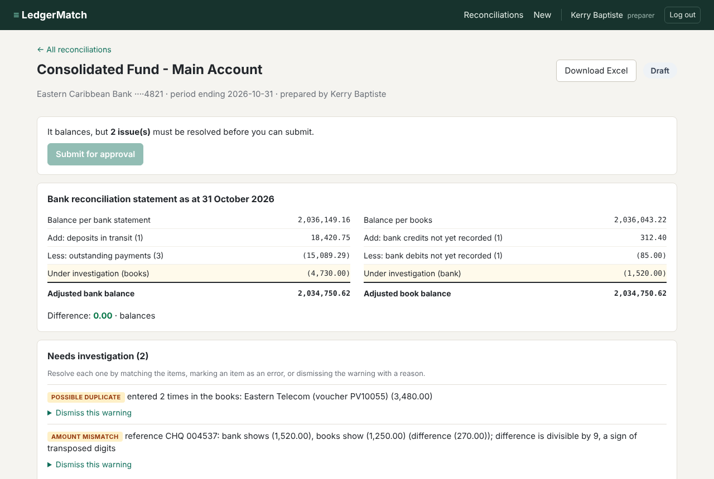
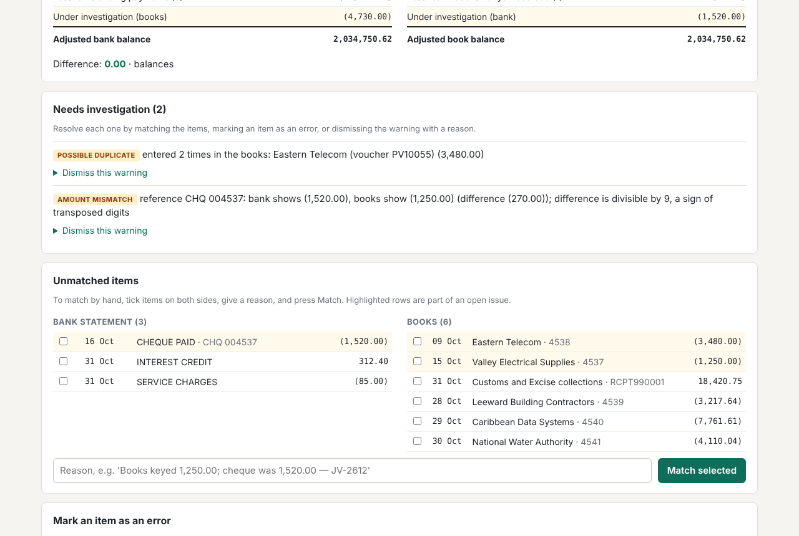
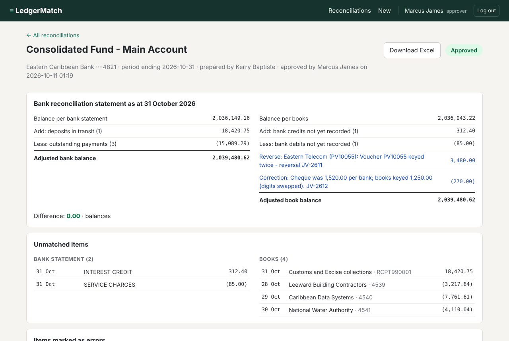
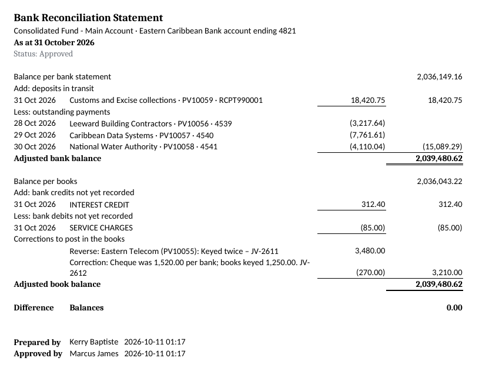

# LedgerMatch

[](https://github.com/Jody2905/ledgermatch/actions/workflows/tests.yml)


**Bank reconciliation for a government cash account: match the bank statement to the cash book, explain every difference, and get it signed off by a second person.**

Every month, finance teams have to prove that the balance in their books agrees with the bank. The two never agree on the day: cheques haven't cleared, deposits are in transit, the bank has charged fees nobody has recorded yet, and occasionally someone keys `1,250.00` instead of `1,520.00`. LedgerMatch automates the matching, flags anything suspicious, builds the reconciliation statement, and records who did what.

> All data in this repository is generated. No real bank or government records are used.



---

## What it does

- **Imports** a bank statement and a cash book from CSV. Every row is validated, and if any row is bad, nothing is saved: a reconciliation with missing transactions is worse than none.
- **Matches automatically** in three passes, from most to least certain:
  1. **Reference**: cheque or transfer number on both sides (`CHQ 004537` = `4537`).
  2. **Amount and date**: same amount within 3 days, used only when there is exactly one candidate.
  3. **Grouped deposits**: one bank deposit that equals the sum of several receipts in the books.
- **Flags problems instead of guessing**:
  - *Possible duplicate*: the same voucher entered twice.
  - *Amount mismatch*: same reference, different amount. If the difference is divisible by 9, it says so, because that is the classic sign of transposed digits (1,520 vs 1,250).
  - *Ambiguous*: more than one possible match, so a person decides.
- **Builds the bank reconciliation statement**: deposits in transit, outstanding payments, bank charges and interest not yet in the books, and corrections, down to an adjusted balance on each side. The difference must be **0.00**.
- **Maker-checker approval**: a preparer resolves the issues and submits; a *different* user with the approver role approves or sends it back with a reason. Once approved, it is locked.
- **Audit trail** of every action with the user, time and reason, including who downloaded a copy.
- **Excel export** laid out like a signed file copy, with live formulas so a reviewer can see how every total is built.

| Resolving the issues | Approved and locked |
|---|---|
|  |  |

**Excel export** (opened in a spreadsheet program; totals are formulas, not typed numbers):



---

## Design decisions

**Money is never a float.** `0.1 + 0.2` is `0.30000000000000004` in floating point, which is how reconciliations end up "off by a cent" for no reason. Amounts are `Decimal` in Python and **whole cents (integers)** in the database. Amounts with more than two decimal places are rejected, not rounded.

**A wrong match is worse than no match.** The matcher only pairs items automatically when there is exactly one sensible candidate. Anything uncertain becomes an issue for a person to decide, so a real error can't be hidden by a convenient match.

**Corrections are explained, not deleted.** A duplicated voucher is *marked as an error* with a reason and journal reference; it then appears on the statement as a correction to post. Nothing is removed from the imported data.

**Segregation of duties is enforced in the service layer, not just hidden in the UI.** The rules (only the preparer can edit or submit; only a different user with the approver role can approve; nothing changes after approval) live in `service.py`, so they apply however the code is called, and they are tested directly.

**Times are stored in UTC and shown in local time**, so records sort and compare correctly wherever the server is.

## Security

- Passwords hashed with **scrypt** and a random salt per user (Python standard library).
- **CSRF token** on every form, compared in constant time; the login form is protected too.
- **Content Security Policy** with no inline scripts or styles, plus `X-Frame-Options: DENY`, `nosniff` and `no-referrer`. Pages with financial data are sent with `Cache-Control: no-store`.
- All database queries are **parameterised** (no SQL built from user input).
- Templates **auto-escape** everything, so a reason such as `<script>` is shown as text. This is tested.
- **Formula injection** blocked in the Excel export: text from uploaded files that starts with `=`, `+`, `-` or `@` is written as text and can never run as a formula.
- Uploads limited to 5 MB and `.csv`, with a safe redirect after login (no open redirects).

## Run it

Needs Python 3.11 or newer.

```bash
git clone https://github.com/Jody2905/ledgermatch.git
cd ledgermatch
python -m pip install -r requirements-dev.txt

python -m ledgermatch init-demo     # database, demo users, an account and a month of sample files
python -m ledgermatch serve         # http://127.0.0.1:5000
```

(On Windows, `py` instead of `python` also works.)

Demo logins (password `Reconcile-2026`): **kbaptiste** and **tlewis** (preparers), **mjames** (approver).

`init-demo` prints the two closing balances to enter on the **New reconciliation** page along with the files in `sample/`.

There is also a command-line version that needs no database:

```bash
python -m ledgermatch sample
python -m ledgermatch reconcile sample/bank_statement_oct2026.csv sample/cash_book_oct2026.csv \
    --bank-balance 2036149.16 --book-balance 2036043.22
```

## Tests

```bash
python -m pytest
```

Over 100 tests cover money parsing, CSV loading (including row numbers in error messages), each matching pass, the statement arithmetic, the approval rules, the web pages (login, CSRF, uploads, escaping) and the Excel formulas. GitHub Actions runs them on Windows and Linux with Python 3.11 and 3.13 on every push.

## Project layout

```
ledgermatch/
  money.py        exact amounts: parsing, formatting
  models.py       BankLine, LedgerEntry, reference clean-up
  loaders.py      CSV import with per-row validation
  matcher.py      the three matching passes and issue detection
  reconcile.py    the reconciliation statement
  schema.sql      database tables, keys and constraints
  service.py      business rules: import, manual work, approval, audit
  export.py       Excel workbook
  web.py          Flask routes, login, CSRF, security headers
  templates/      HTML pages
tests/            pytest suite
```

## Database

SQLite, with foreign keys switched on. Main tables:

| Table | Holds |
|---|---|
| `users` | login, display name, role (preparer / approver), password hash |
| `accounts` | bank accounts being reconciled |
| `runs` | one reconciliation per account per period (enforced by a UNIQUE constraint), its status and who prepared / approved it |
| `bank_lines`, `ledger_entries` | imported rows, amounts in cents, with an optional error reason |
| `matches`, `match_items` | which rows were matched, by which rule, and any difference; an item can only be in one match |
| `issues`, `issue_items` | duplicates, mismatches and ambiguities, and who dismissed them and why |
| `audit_log` | every action with user, time and detail |

## Possible next steps

- PostgreSQL support for multi-user deployment
- Importing bank statements in bank formats (e.g. ISO 20022 camt.053)
- Rolling outstanding items forward into next month's reconciliation

---

Built by **Jody-Ann Trimmingham** · [GitHub](https://github.com/Jody2905)
